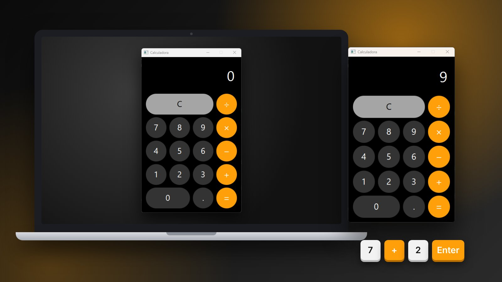
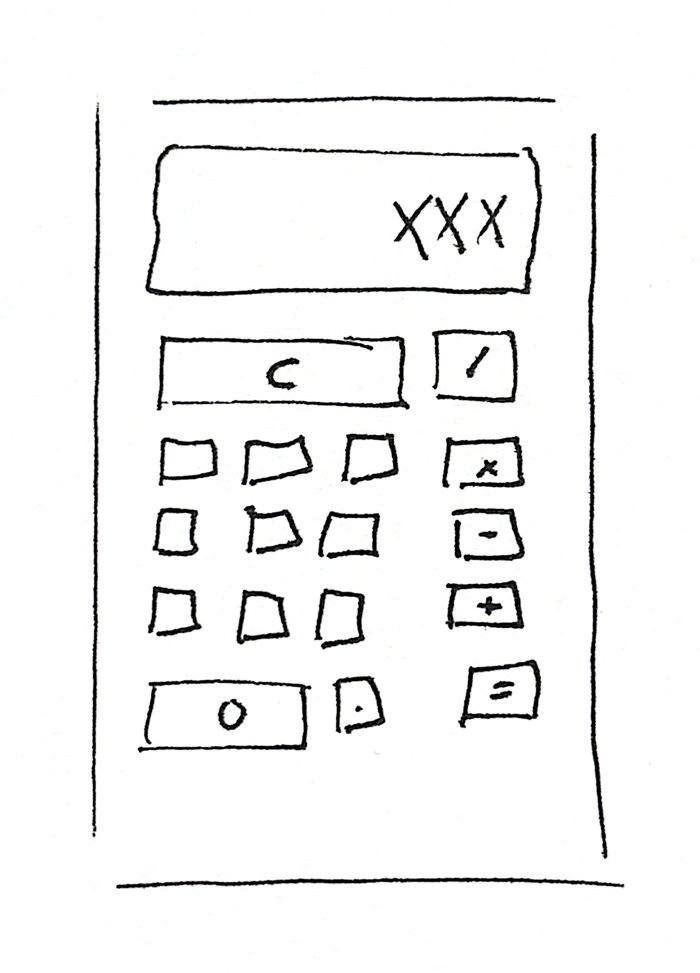
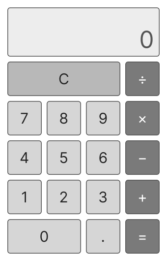
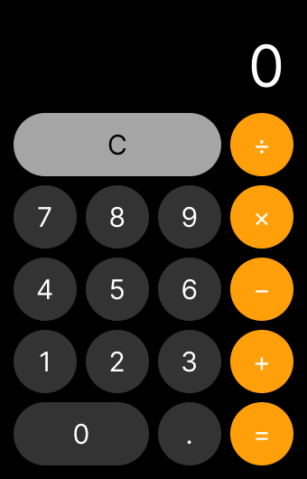
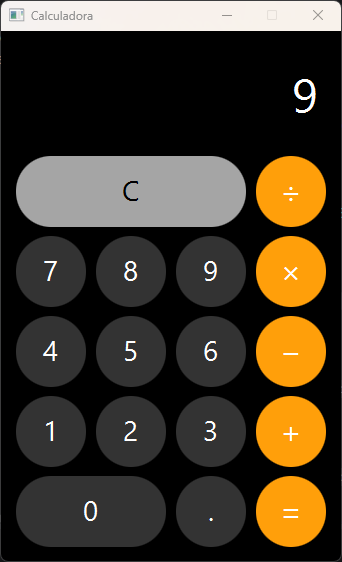
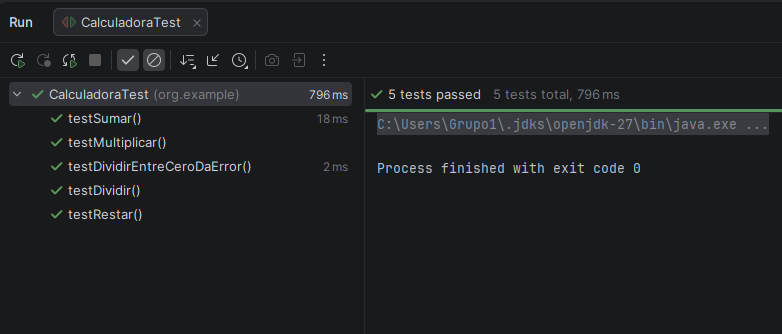

<div align="center">
  
</div>

<div align="center">
  <a href="https://github.com/evagr11/Calculadora" target="_blank">
    
  </a>
  <a href="https://github.com/evagr11/Calculadora/releases/latest" target="_blank">
    
  </a>
  <a href="https://evagr11.github.io/Calculadora/" target="_blank">
    
  </a>
  <a href="documentacion/Calculadora_II.pdf" target="_blank">
    
  </a>
  <a href="https://www.figma.com/design/fG8BWf2mneEuCanVuY8ATo/Calculadora-JavaFX---Wireframe-y-Prototipo?node-id=1-2" target="_blank">
    
  </a>
</div>

<br>

<div align="center">
  <a href="https://git.io/typing-svg"></a>
</div>

<div align="center">
  
</div>

---

# 🧮 Sobre el Proyecto

**Calculadora** es una aplicación de escritorio hecha en **JavaFX** que realiza las cuatro operaciones básicas: suma, resta, multiplicación y división. Se maneja **con el ratón y con el teclado**.

La interfaz está definida en **FXML** y tiene un diseño oscuro con botones redondeados. La lógica está separada siguiendo el patrón **MVC**, de modo que el modelo que hace las cuentas no sabe nada de botones ni de ventanas.

✨ **Características principales:**

- ➕ **Cuatro operaciones**: suma, resta, multiplicación y división.
- ⌨️ **Uso con el teclado**: números (también del teclado numérico), operaciones, punto, `Enter` para el resultado y `Ctrl + C` para borrar.
- 🔗 **Operaciones encadenadas**: si ya hay una operación pendiente, se calcula al pulsar el siguiente operador (`2 + 3 + 4` da `9`).
- 🔢 **Números decimales**: el punto solo se puede añadir una vez por número.
- 🚫 **División entre cero controlada**: el modelo lanza una `ArithmeticException` y la pantalla muestra `Error`.
- 🎯 **Resultados limpios**: los enteros se muestran sin `.0` y los decimales se redondean a 8 cifras, así no aparecen cosas como `0.30000000000000004`.
- 📏 **Límite de 10 caracteres** para que el número siempre quepa en la pantalla.
- ✅ **Pruebas unitarias** del modelo con **JUnit 5**.
- 📖 **Documentación Javadoc** generada en la carpeta `docs/` y publicada en [GitHub Pages](https://evagr11.github.io/Calculadora/).

---

# 🧠 Contexto del Proyecto

Este proyecto es una práctica de la asignatura **Desarrollo de Interfaces** del segundo curso de **DAM** (Desarrollo de Aplicaciones Multiplataforma), hecha en dos tareas:

<div align="center">

| Tarea | Qué se hizo |
| :---- | :---------- |
| **006 – Calculadora** | Diseño (sketch, wireframe y prototipo) e implementación con JavaFX, MVC, JUnit y Javadoc |
| **010 – Calculadora II** | Uso con el teclado: números, operaciones, resultado y `Ctrl + C` para borrar |

</div>

Todo está explicado en la [documentación en PDF](documentacion/Calculadora_II.pdf) (LaTeX): requisitos, diseño, estilo visual, implementación, pruebas y código.

---

# 🎨 Del boceto a la aplicación

<table align="center">
  <tr>
    <td align="center" width="25%"><br><em>1. Sketch</em></td>
    <td align="center" width="25%"><br><em>2. <a href="https://www.figma.com/design/fG8BWf2mneEuCanVuY8ATo/Calculadora-JavaFX---Wireframe-y-Prototipo">Wireframe</a></em></td>
    <td align="center" width="25%"><br><em>3. <a href="https://www.figma.com/design/fG8BWf2mneEuCanVuY8ATo/Calculadora-JavaFX---Wireframe-y-Prototipo?node-id=1-2">Prototipo</a></em></td>
    <td align="center" width="25%"><br><em>4. JavaFX</em></td>
  </tr>
</table>

---

# 🛠️ Stack Tecnológico

<p align="center">
  
  
  
  
  
  
</p>

<div align="center">

| Área | Tecnología |
|------|------------|
| **Lenguaje** | `Java 11` |
| **Interfaz** | `JavaFX 13` (`javafx-controls`, `javafx-fxml`) |
| **Vista** | `FXML` con estilos `-fx-*` en línea |
| **Build** | `Maven` + `javafx-maven-plugin` |
| **Pruebas** | `JUnit Jupiter 5.10` |
| **Documentación** | `Javadoc` |

</div>

---

# 🧩 Arquitectura (MVC)

<div align="center">

| Capa | Archivo | Responsabilidad |
|------|---------|-----------------|
| 🟠 **Modelo** | `Calculadora.java` | Las cuatro operaciones. Lanza una excepción al dividir entre 0 |
| ⚫ **Vista** | `calculadora.fxml` | Pantalla (`Label`) y botonera en un `GridPane` de 4 × 5 |
| ⚪ **Controlador** | `CalculadoraController.java` | Recoge los clics, guarda el estado y llama al modelo |
| ▶️ **Arranque** | `App.java` | Carga el FXML y abre una ventana de tamaño fijo |

</div>

Cada botón de operación guarda su símbolo en `userData` (`+`, `-`, `*`, `/`). Así un único método, `pulsarOperacion`, sirve para los cuatro operadores, y lo mismo pasa con `pulsarNumero` para los diez dígitos.

---

# ⌨️ Uso con el teclado

<div align="center">

| Tecla | Acción |
| :---- | :----- |
| `0`–`9` (normal o numérico) | Escribe el número |
| `+` `-` `*` `/` | Elige la operación |
| `.` o `,` | Punto decimal |
| `Enter` o `=` | Muestra el resultado |
| `Ctrl + C` | Borra, igual que el botón `C` |

</div>

`App` registra un manejador con `escena.setOnKeyPressed(...)` y le pasa cada tecla a `teclaPulsada` del controlador, que llama a los mismos métodos que los botones: el resultado es igual con el ratón que con el teclado. Se pone en la **escena** porque los eventos suben desde el nodo con el foco hasta la raíz, y los botones tienen `focusTraversable="false"` para que `Enter` no pulse uno por error.

En el teclado español, `/`, `*` y `=` se escriben con **Mayúsculas** (`Mayús + 7`, `Mayús + +` y `Mayús + 0`), y el controlador las reconoce así; con otras distribuciones funcionan las teclas del teclado numérico.

---

# 📂 Estructura del Proyecto

```bash
Calculadora/
│
├── pom.xml
├── docs/                          # Javadoc generado (publicado en GitHub Pages)
├── documentacion/
│   └── Calculadora_II.pdf         # Memoria de la práctica
│
└── src/
    ├── main/
    │   ├── java/
    │   │   ├── module-info.java
    │   │   └── org/example/
    │   │       ├── App.java                    # Arranque
    │   │       ├── Calculadora.java            # Modelo
    │   │       └── CalculadoraController.java  # Controlador
    │   └── resources/
    │       └── org/example/
    │           └── calculadora.fxml            # Vista
    │
    └── test/
        └── java/org/example/
            └── CalculadoraTest.java            # Pruebas JUnit
```

---

# 🖥️ Interfaz

<table align="center">
  <tr>
    <td align="center" valign="middle">
      
      
      <p><em>Resultado y división entre cero</em></p>
    </td>
    <td valign="middle">
      <table>
        <tr>
          <th>Elemento</th>
          <th>Color</th>
        </tr>
        <tr>
          <td>Fondo</td>
          <td></td>
        </tr>
        <tr>
          <td>Números y punto</td>
          <td></td>
        </tr>
        <tr>
          <td>Operadores e igual</td>
          <td></td>
        </tr>
        <tr>
          <td>Borrar (C)</td>
          <td></td>
        </tr>
      </table>
    </td>
  </tr>
</table>

---

# 🚀 Cómo Utilizar el Proyecto

### 💻 Descargar para Windows

No hace falta tener Java instalado: la descarga lleva su propia versión.

1. Descarga `Calculadora-windows.zip` de la [última versión](https://github.com/evagr11/Calculadora/releases/latest) y descomprímelo.
2. Abre la carpeta `bin` y haz doble clic en `Calculadora.bat` (si el Explorador oculta las extensiones, aparece como `Calculadora`).

### 📋 Requisitos para compilarla

- **JDK 11** o superior
- **Maven** (o el Maven que trae IntelliJ IDEA)

### ▶️ Ejecutar la aplicación

```bash
git clone https://github.com/evagr11/Calculadora.git
cd Calculadora
mvn clean javafx:run
```

En **IntelliJ IDEA** también se puede lanzar desde el panel de Maven: `Plugins → javafx → javafx:run`.

### 📦 Generar el zip para Windows

```bash
mvn clean javafx:jlink
```

Crea `target/Calculadora-windows.zip`, con la aplicación y un Java reducido para ejecutarla. Se genera para el sistema donde se compila: hecho en Windows, funciona en Windows.

### ✅ Ejecutar las pruebas

```bash
mvn test
```

| Prueba | Comprueba |
|--------|-----------|
| `testSumar` | `5 + 3 = 8` |
| `testRestar` | `5 - 3 = 2` |
| `testMultiplicar` | `5 × 3 = 15` |
| `testDividir` | `5 ÷ 2 = 2.5` |
| `testDividirEntreCeroDaError` | `5 ÷ 0` lanza `ArithmeticException` |

<div align="center">
  
</div>

### 📖 Ver la documentación

Consulta el **Javadoc** de todas las clases online en **[evagr11.github.io/Calculadora](https://evagr11.github.io/Calculadora/)**, o abre `docs/index.html` en el navegador si tienes el proyecto clonado.

---

# 📚 Lo que aprendí con este proyecto

- Diseñar una interfaz paso a paso: **sketch**, **wireframe** y **prototipo** en Figma
- Crear interfaces de escritorio con **JavaFX** y **FXML**
- Conectar la vista con el controlador mediante `fx:id`, `onAction` y `@FXML`
- Aplicar el patrón **MVC** separando la lógica de la interfaz
- Maquetar con `VBox` y `GridPane` usando `columnSpan`
- Reutilizar un mismo manejador para varios botones con `userData`
- Escuchar el teclado en la escena con `setOnKeyPressed`, `KeyCode` y `KeyCodeCombination`
- Controlar errores con **excepciones** y mostrarlos al usuario
- Evitar los problemas de precisión de los `double` al mostrar resultados
- Escribir **pruebas unitarias** con JUnit 5 y documentar con **Javadoc**

---

# 🎯 Mejoras futuras

- 🔙 Borrar el último dígito con un botón y con la tecla de retroceso
- ⎋ `Esc` como atajo para borrar, además de `Ctrl + C`
- ➕ Prioridad de operaciones: ahora `2 + 3 × 4` se calcula de izquierda a derecha y da `20`
- 📏 Ajustar los resultados muy grandes al límite de 10 caracteres de la pantalla
- ➗ Operaciones extra: porcentaje, cambio de signo (`±`) y raíz cuadrada
- 🎨 Llevar los estilos a una hoja **CSS** externa
- 🧪 Pruebas del controlador con **TestFX**
- 📦 **Instalador `.exe`** con icono y acceso en el menú Inicio, con `jpackage`, en vez de abrirla con un `.bat`

---

<div align="center">
  <p>Creado por <strong>Eva Gallardo</strong></p>
  <a href="https://github.com/evagr11" target="_blank">
    
  </a>
  <a href="https://www.linkedin.com/in/eva-gallardo-romero-830362349/" target="_blank">
    
  </a>
</div>

<div align="center">
  
</div>
